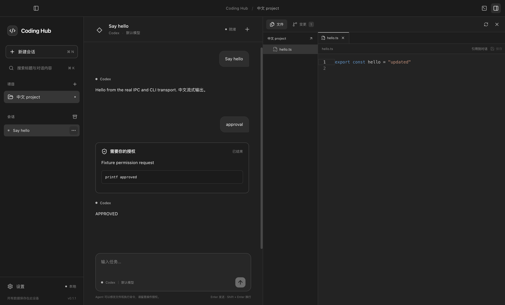

# Coding Hub

面向个人开发者的本地多 Agent 编程工作台。连接已安装的 Claude Code、Codex CLI 和 OpenCode，在一个桌面应用中完成任务、代码审阅、检查和 Git 交付。

当前代码版本为 **0.1.1**，按 [产品交付清单](docs/product-plan.md) 交付自用版本：使用 `internal` 构建并手动更新，无需真实发行证书、公证身份或生产更新源。签名发行候选保留为未来对外分发的可选流程；实际验证与用户暂缓的三项质量验收见 [验证记录](docs/verification.md)。



截图中的聊天来自协议夹具；当前界面以实际运行版本为准。界面以中文和黑白灰为主，代码、差异和终端保留语义颜色。

## 开始使用

已安装应用的用户需要 **Git** 和至少一个已在终端完成安装、登录的 Agent CLI。应用包自带 Electron 运行时；各 CLI 自身的运行环境要求由对应工具决定。

从源码运行需要 Node.js 24、pnpm 11.24.0：

```sh
pnpm install --frozen-lockfile
pnpm dev
```

1. 打开或创建项目；也可以克隆不含凭据的 HTTPS / SSH 仓库地址。
2. 查看目录后明确设为可信项目，启用编辑、Agent、检查、终端和 Git 操作。
3. 在「设置 → Agent 连接」检查安装、版本、登录和模型状态。可填写 CLI 完整路径；“CLI 可用”不代表账号或模型权限已验证。
4. 新建会话，选择 Agent、模型和工作区。有 Git 提交的项目默认创建独立 worktree；非 Git 或尚无提交的项目使用共享目录。
5. 输入任务，按实际请求允许、拒绝或补充信息。执行完成后查看本轮变更，运行检查，再审阅暂存内容并提交、推送。

完整步骤见 [安装、首次使用与升级](docs/install-and-upgrade.md)。

当前适配器检查的 CLI 最低版本：

| Agent       | 最低版本 | 安装与登录说明                                                |
| ----------- | -------- | ------------------------------------------------------------- |
| Claude Code | 2.1.236  | [Claude Code 官方文档](https://code.claude.com/docs/en/setup) |
| Codex CLI   | 0.151.0  | [Codex CLI 官方文档](https://developers.openai.com/codex/cli) |
| OpenCode    | 1.19.5   | [OpenCode 官方文档](https://opencode.ai/docs/)                |

版本满足要求仍可能遇到账号、模型或协议变化。客户端使用原 CLI 的登录和项目配置，不托管订阅凭据，也不自动执行安装、登录或项目脚本。

## 工作方式

| 环节         | 当前能力与边界                                                                                                              |
| ------------ | --------------------------------------------------------------------------------------------------------------------------- |
| 项目与工作区 | 项目信任、创建 / 克隆、移除与恢复；独立 worktree 的比较、应用和清理。既有原生会话保持原 cwd。                               |
| 会话组织     | 置顶、归档、回收与恢复、标题和内容搜索、匹配定位、Markdown / JSON 导出、全局任务收件箱。                                    |
| 任务输入     | 多份文件 / 选区、终端 / 检查输出、diff 和图片引用，支持预览；能力和大小限制以界面为准。                                     |
| 执行控制     | 流式回答、工具详情、原生授权和问答、停止及失败状态；完成、失败和待回复通知。                                                |
| 编辑恢复     | 输入草稿、引用、编辑缓冲区和视图状态按会话 / 工作区恢复。磁盘变化时比较、重新加载或明确覆盖。                               |
| 文件         | 文件树、快开、内容搜索、创建 / 改名 / 永久删除、保存全部和外部编辑器。内置编辑器支持不超过 2 MB 的 UTF-8 文本。             |
| 审阅与撤销   | 记录本轮基线以来的变化；完整文本快照可选择撤销，后续修改或冲突会阻止覆盖。二进制、敏感配置和容量外文件不提供自动撤销。      |
| 检查         | 发现 `package.json` scripts，由用户明确执行；保留实际退出码、输出和所属回合，支持取消。                                     |
| Git          | 暂存 / 未暂存分组 diff、分支创建 / 切换、暂存提交预览、历史、上游与领先 / 落后状态、fetch、仅快进 pull、普通 push。         |
| 终端         | 原生 PTY，多终端、搜索、输出引用、隐藏和重新连接；明确区分新建、重启和终止。                                                |
| 数据维护     | SQLite 迁移、完整性检查、每日 / 手动 / 升级前备份、长输出附件同步恢复、脱敏诊断导出。应用数据备份不等于项目或完整设备备份。 |

独立 worktree 从已提交的基线创建，**不会额外复制原目录未提交的修改或被忽略的配置、依赖目录**；已提交的文件仍按基线检出。在同一共享工作区运行的 Agent / 检查受互斥保护；不同 worktree 可并行。外部编辑器、手动终端和其他程序仍能改变文件，因此应用改动和撤销都需要冲突检查。

关闭窗口后，应用留在托盘继续后台工作；从应用菜单或托盘退出会停止受管工作。应用 / 后台服务恢复时，中断任务不会自动重新发送。原生会话恢复还依赖对应 CLI 保存的历史与配置。

## 平台与验证

| 目标             | 当前证据                                                                                          |
| ---------------- | ------------------------------------------------------------------------------------------------- |
| macOS x64        | 本机与原生 CI 通过源码、包内应用、旧版升级和保留数据卸载；详见 [验证记录](docs/verification.md)。 |
| macOS arm64      | 原生架构 CI 通过源码、内部包、旧版升级和保留数据卸载；使用虚拟化 runner。                         |
| 原生 Windows x64 | 原生 CI 通过源码、包内应用及真实 NSIS 安装、旧版升级和保留数据卸载。                              |

不支持 Linux / WSL。当前不包含云同步、团队账号、远程执行、扩展市场、完整 LSP、跨 Agent 自动接力或外部 CLI 历史导入。

## 快捷键

macOS 使用 `⌘`，Windows 使用 `Ctrl`。输入框的发送方式可以在设置中调整。

| 快捷键                 | 操作                               |
| ---------------------- | ---------------------------------- |
| ⌘/Ctrl + N             | 新建会话                           |
| ⌘/Ctrl + K             | 搜索会话                           |
| ⌘/Ctrl + Shift + P     | 命令面板                           |
| ⌘/Ctrl + ,             | 打开设置                           |
| ⌘/Ctrl + B / J         | 切换侧栏 / 终端                    |
| ⌘/Ctrl + P             | 文件快开，代码工作区可见时生效     |
| ⌘/Ctrl + Shift + F     | 文件内容搜索，代码工作区可见时生效 |
| ⌘/Ctrl + S / Shift + S | 保存当前文件 / 全部文件            |

## 数据、恢复与发行

- [安装、首次使用与升级](docs/install-and-upgrade.md)
- [数据、备份与故障恢复](docs/data-and-recovery.md)
- [隐私与问题反馈](docs/privacy-and-support.md)
- [内部打包、签名候选和更新源](docs/releasing.md)
- [变更记录](docs/changelog.md)

默认数据目录为 macOS 的 `~/Library/Application Support/coding-hub` 或 Windows 的 `%APPDATA%/coding-hub`。在「设置 → 数据与备份」中打开实际目录。开发测试可通过 `CODING_HUB_USER_DATA` 使用独立目录。

## 开发与验证

```sh
pnpm typecheck
pnpm test
pnpm build
pnpm test:e2e
pnpm format:check
```

测试通过 Electron 自带 Node 运行原生模块；普通服务与 UI 测试使用隔离目录、真实临时 Git 仓库和可控的三种 CLI 协议夹具，不向真实模型发送请求。构建输出在 `out/`。

```sh
pnpm package:dir
pnpm test:packaged
```

安装包输出在 `release/`。应在目标系统构建、运行 packaged E2E，并另行验收安装、升级与卸载。签名、公证和生产自动更新属于未来对外分发流程，非当前自用要求；具体步骤见 [发行指南](docs/releasing.md)。

真实账号测试仅显式启用 `CODING_HUB_LIVE_SMOKE=1` 后运行 `scripts/live-smoke.mjs`，会产生原 CLI 的请求与账号用量。可用 `CODING_HUB_CODEX_MODEL` 指定测试模型。官方 OpenCode 二进制的无模型协议检查见 `scripts/opencode-server-smoke.mjs`。

架构分为 React / Monaco / xterm renderer、受控 typed preload、负责持久化和桌面集成的 Electron main，以及负责 CLI、文件、Git、PTY、检查和快照的 utility process。适配器需保留原生 session ID、回合 item identity、授权和取消语义；renderer 不直接访问文件系统、Git、进程或凭据。

贡献使用 pnpm 和 Conventional Commits。适配器变更补协议测试，桌面流程变更执行上述完整检查。问题报告可使用仓库 Issue 模板；请先查看 [反馈与隐私边界](docs/privacy-and-support.md)。

## License

[MIT](LICENSE)。各 Agent CLI 与模型服务遵循各自的许可和服务条款。
